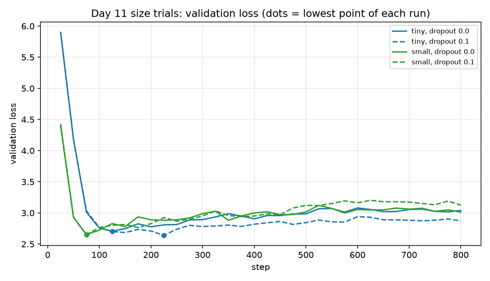

# Day 11 report: size trials and the size decision

Generated by `scripts/day11_size_trials.py` (day11-v1) on 2026-11-18 12:18. Machine: home, NVIDIA GeForce RTX 4060 Laptop GPU, PyTorch 2.15.0+cu132, Python 3.11.6.

Every run: batch 32 x 256 tokens, 800 steps, warm-up 60, peak learning rate 0.001, seed 43, validation every 25 steps. Only the size and the dropout differ.

## Decision

**Chosen: `tiny_d10`** (tiny, dropout 0.1, 1,001,856 parameters), best validation loss 2.6397 (perplexity 14.01) at step 225.

Reason: tiny_d10 has the lowest validation loss (2.6397) and is also the smallest of the runs within the tolerance.

Rule (written before the trials): keep runs whose best checkpoint passes the task 6 automatic guidelines (finished >= 90 %, repetitive <= 5 % with greedy + limits on the 12 fixed prompts); among them, every run within 0.02 of the lowest validation loss counts as equally good, and the one with the fewest parameters is chosen.

Runs within the tolerance: tiny_d10, small_d00, small_d10. Rejected by the checks: none.

## Results

| Run | Parameters | Best val loss | Perplexity | At step | Train loss there | Gap | Final val loss | Rise after best | Tokens/s | Peak MB | Finished | Repetitive | distinct-2 |
| --- | --- | --- | --- | --- | --- | --- | --- | --- | --- | --- | --- | --- | --- |
| tiny_d00 | 1,001,856 | 2.7065 | 14.98 | 125 | 1.5911 | 1.115 | 3.0394 | +0.333 | 666,918 | 407 | 100% | 0% | 0.35 |
| tiny_d10 | 1,001,856 | 2.6397 | 14.01 | 225 | 1.2095 | 1.430 | 2.8734 | +0.234 | 635,920 | 416 | 100% | 0% | 0.59 |
| small_d00 | 5,150,464 | 2.6537 | 14.21 | 75 | 1.7245 | 0.929 | 3.0114 | +0.358 | 247,015 | 874 | 100% | 0% | 0.32 |
| small_d10 | 5,150,464 | 2.6513 | 14.17 | 75 | 1.7857 | 0.866 | 3.1257 | +0.474 | 244,826 | 899 | 100% | 0% | 0.33 |

Gap = validation loss minus training loss at the best step (how much harder unseen sentence patterns are). Rise after best = final validation loss minus the best (how much the run overfitted afterwards). Finished / Repetitive / distinct-2: task 6 items A2-A4 on the best checkpoint, greedy + limits.

## Sample sentences from each best checkpoint

Greedy + repetition limits (`⟨eos⟩` = finished, `…` = cut at 40 tokens):

| Run | 営業部の | ボーナスが | 勤続年数が | 今日は |
| --- | --- | --- | --- | --- |
| tiny_d00 | 社員のうち、年収が5000時間未満の人は誰ですか。 ⟨eos⟩ | 300万円以下の社員を教えてください。 ⟨eos⟩ | 30万円以下の社員を教えてください。 ⟨eos⟩ | 誰ですか。 ⟨eos⟩ |
| tiny_d10 | 社員の割合を出してください。 ⟨eos⟩ | 30万円以上の社員を教えてください。 ⟨eos⟩ | 30年以上の社員を教えてください。 ⟨eos⟩ | 何人いますか。 ⟨eos⟩ |
| small_d00 | 社員を教えてください。 ⟨eos⟩ | 50000万円以下の社員を教えてください。 ⟨eos⟩ | 50000万円以下の社員を教えてください。 ⟨eos⟩ | 誰？ ⟨eos⟩ |
| small_d10 | 社員を教えてください。 ⟨eos⟩ | 30万円以下の社員を教えてください。 ⟨eos⟩ | 30万円以下の社員を教えてください。 ⟨eos⟩ | 社員は誰ですか。 ⟨eos⟩ |

Sampling (temperature 0.8, top-k 50, top-p 0.95, fixed seed):

| Run | 営業部の | ボーナスが | 勤続年数が | 今日は |
| --- | --- | --- | --- | --- |
| tiny_d00 | 社員を出して。 ⟨eos⟩ | 3万円超の社員を教えてください。 ⟨eos⟩ | 知りたいです。 ⟨eos⟩ | 何人いますか。 ⟨eos⟩ |
| tiny_d10 | 社員の性別と勤続年数を見せてください。 ⟨eos⟩ | 300万円以上の社員は何人いますか。 ⟨eos⟩ | 30年超の社員は何人いますか。 ⟨eos⟩ | 何人いますか。 ⟨eos⟩ |
| small_d00 | 社員を在籍年数が誰ですか。 ⟨eos⟩ | 3万円超の社員を教えてください。 ⟨eos⟩ | 知りたいです。 ⟨eos⟩ | 何人いますか。 ⟨eos⟩ |
| small_d10 | 社員を性別はいくつありますか。 ⟨eos⟩ | 3万円超の社員を教えてください。 ⟨eos⟩ | 知りたいです。 ⟨eos⟩ | 社員を教えてください。 ⟨eos⟩ |
