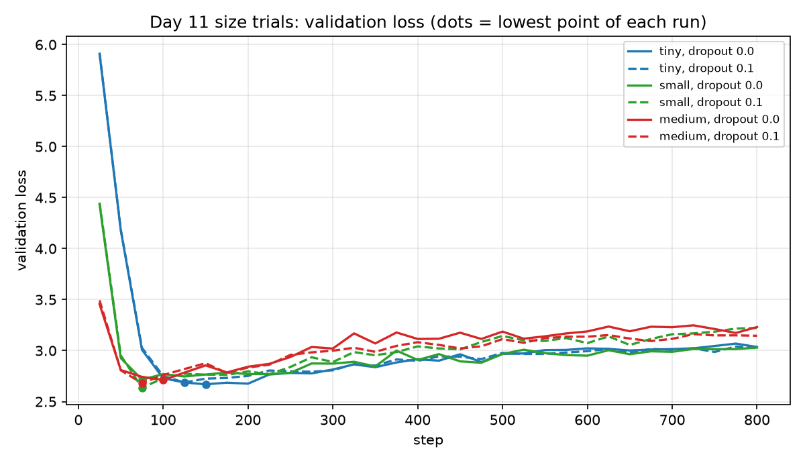

# Day 11 report: size trials and the size decision

Generated by `scripts/day11_size_trials.py` (day11-v1) on 2026-11-18 12:12. Machine: home, NVIDIA GeForce RTX 4060 Laptop GPU, PyTorch 2.15.0+cu132, Python 3.11.6.

Every run: batch 32 x 256 tokens, 800 steps, warm-up 60, peak learning rate 0.001, seed 42, validation every 25 steps. Only the size and the dropout differ.

## Decision

**Chosen: `small_d10`** (small, dropout 0.1, 5,150,464 parameters), best validation loss 2.6351 (perplexity 13.94) at step 75.

Reason: small_d10 has the lowest validation loss (2.6351).

Rule (written before the trials): keep runs whose best checkpoint passes the task 6 automatic guidelines (finished >= 90 %, repetitive <= 5 % with greedy + limits on the 12 fixed prompts); among them, every run within 0.02 of the lowest validation loss counts as equally good, and the one with the fewest parameters is chosen.

Runs within the tolerance: small_d10. Rejected by the checks: none.

## Results

| Run | Parameters | Best val loss | Perplexity | At step | Train loss there | Gap | Final val loss | Rise after best | Tokens/s | Peak MB | Finished | Repetitive | distinct-2 |
| --- | --- | --- | --- | --- | --- | --- | --- | --- | --- | --- | --- | --- | --- |
| tiny_d00 | 1,001,856 | 2.6692 | 14.43 | 150 | 1.4059 | 1.263 | 3.0357 | +0.366 | 648,838 | 407 | 100% | 0% | 0.36 |
| tiny_d10 | 1,001,856 | 2.6876 | 14.70 | 125 | 1.6712 | 1.016 | 3.0233 | +0.336 | 568,483 | 416 | 100% | 0% | 0.32 |
| small_d00 | 5,150,464 | 2.7155 | 15.11 | 75 | 1.7143 | 1.001 | 3.0298 | +0.314 | 237,147 | 874 | 100% | 0% | 0.27 |
| small_d10 | 5,150,464 | 2.6351 | 13.94 | 75 | 1.7820 | 0.853 | 3.2218 | +0.587 | 242,241 | 899 | 100% | 0% | 0.27 |
| medium_d00 | 14,805,120 | 2.7115 | 15.05 | 100 | 1.2293 | 1.482 | 3.2308 | +0.519 | 106,458 | 1,627 | 100% | 0% | 0.48 |
| medium_d10 | 14,805,120 | 2.6812 | 14.60 | 75 | 1.5341 | 1.147 | 3.1458 | +0.465 | 107,573 | 1,680 | 100% | 0% | 0.33 |

Gap = validation loss minus training loss at the best step (how much harder unseen sentence patterns are). Rise after best = final validation loss minus the best (how much the run overfitted afterwards). Finished / Repetitive / distinct-2: task 6 items A2-A4 on the best checkpoint, greedy + limits.

## Sample sentences from each best checkpoint

Greedy + repetition limits (`⟨eos⟩` = finished, `…` = cut at 40 tokens):

| Run | 営業部の | ボーナスが | 勤続年数が | 今日は |
| --- | --- | --- | --- | --- |
| tiny_d00 | 社員の月収と入社日を出してください。 ⟨eos⟩ | 300万円未満の社員を教えてください。 ⟨eos⟩ | 30%以上の社員を教えてください。 ⟨eos⟩ | 誰ですか。 ⟨eos⟩ |
| tiny_d10 | 社員を教えてください。 ⟨eos⟩ | 300万円超の社員を教えてください。 ⟨eos⟩ | 300万円超の社員を教えてください。 ⟨eos⟩ | 誰ですか。 ⟨eos⟩ |
| small_d00 | 社員を教えてください。 ⟨eos⟩ | 50000万円未満の社員を教えてください。 ⟨eos⟩ | 50000万円未満の社員を教えてください。 ⟨eos⟩ | 誰ですか。 ⟨eos⟩ |
| small_d10 | 社員を教えてください。 ⟨eos⟩ | 50000万円未満の社員を教えてください。 ⟨eos⟩ | 50000万円未満の社員を教えてください。 ⟨eos⟩ | 誰ですか。 ⟨eos⟩ |
| medium_d00 | 社員を除いた年収の平均を教えてください。 ⟨eos⟩ | 100万円以上の社員を教えてください。 ⟨eos⟩ | 10人は何人ですか。 ⟨eos⟩ | 何人いますか。 ⟨eos⟩ |
| medium_d10 | 社員を教えてください。 ⟨eos⟩ | 300万円未満の社員を教えてください。 ⟨eos⟩ | 300万円未満の社員を教えてください。 ⟨eos⟩ | 誰ですか。 ⟨eos⟩ |

Sampling (temperature 0.8, top-k 50, top-p 0.95, fixed seed):

| Run | 営業部の | ボーナスが | 勤続年数が | 今日は |
| --- | --- | --- | --- | --- |
| tiny_d00 | 社員の月収と入社年月日を出してください。 ⟨eos⟩ | 30%以上の社員を教えてください。 ⟨eos⟩ | 高い？ ⟨eos⟩ | 何人いますか。 ⟨eos⟩ |
| tiny_d10 | 社員を見せてください。 ⟨eos⟩ | 3万円超の社員を教えてください。 ⟨eos⟩ | 知りたいです。 ⟨eos⟩ | 何人いますか。 ⟨eos⟩ |
| small_d00 | 社員の中央値は誰ですか。 ⟨eos⟩ | 5万円超の社員を教えてください。 ⟨eos⟩ | 知りたいです。 ⟨eos⟩ | 平均よりどれくらい高いですか。 ⟨eos⟩ |
| small_d10 | 社員を出してください。 ⟨eos⟩ | 3万円超の社員を教えてください。 ⟨eos⟩ | 知りたいです。 ⟨eos⟩ | 平均より低い社員の最高額を教えてください。 ⟨eos⟩ |
| medium_d00 | 社員を除いた有給消化率の最低額を教えてください。 ⟨eos⟩ | 300万円以上の社員は何人いますか。 ⟨eos⟩ | 10年超の社員のうち、管理職手当が10万円以下の人は誰ですか。 ⟨eos⟩ | 何人いますか。 ⟨eos⟩ |
| medium_d10 | 社員を教えてください。 ⟨eos⟩ | 30%で、部長の人を一覧にしてください。 ⟨eos⟩ | 知りたいです。 ⟨eos⟩ | 何人いますか。 ⟨eos⟩ |
