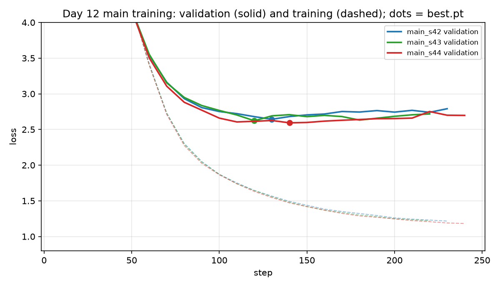

# Day 12 report: main training run

Generated by `scripts/day12_train_main.py` (day12-v1) on 2026-11-18 12:58. Machine: home, NVIDIA GeForce RTX 4060 Laptop GPU, PyTorch 2.15.0+cu132, Python 3.11.6.

Configuration from Day 11: **tiny, dropout 0.1** (1,001,856 parameters). Batch 32 x 256 tokens, 400-step schedule (warm-up 60, peak learning rate 0.001, cosine to 10 %), validation every 10 steps, early stopping after 100 steps without improvement, seeds 42, 43, 44. The test set was not used.

## Final model

**`runs/day12/main_s44/best.pt`**: best validation loss 2.5935 (perplexity 13.38) at step 140. On the 12 fixed prompts (greedy + limits): finished 100%, repetitive 0%, distinct-2 0.44 (task 6 guidelines: finished >= 90%, repetitive <= 5%).

## All seeds

| Run | How it ended | Best val loss | Perplexity | At step | Train loss there | Gap | Finished | Repetitive | distinct-2 | New sentences |
| --- | --- | --- | --- | --- | --- | --- | --- | --- | --- | --- |
| main_s42 | early_stopped at step 230 | 2.6430 | 14.06 | 130 | 1.5662 | 1.077 | 100% | 0% | 0.32 | 11/12 |
| main_s43 | early_stopped at step 220 | 2.6221 | 13.76 | 120 | 1.6438 | 0.978 | 100% | 0% | 0.30 | 11/12 |
| main_s44 | early_stopped at step 240 | 2.5935 | 13.38 | 140 | 1.4713 | 1.122 | 100% | 0% | 0.44 | 11/12 |

Mean best validation loss 2.6195 (perplexity 13.73); spread between seeds 0.0495.

## Compared with the Day 11 trials of the same configuration

| | Schedule | Seeds | Mean best validation loss |
| --- | --- | --- | --- |
| Day 11 trials | 800 steps | 2 | 2.6637 |
| Day 12 main | 400 steps + early stopping | 3 | 2.6195 |

Change: -0.0441. Read it against the seed spread above: a change smaller than the spread is not evidence of improvement.

## Sample sentences (final model)

| Beginning | Greedy + limits | Sampling (T 0.8, top-k 50, top-p 0.95) |
| --- | --- | --- |
| 営業部の | 社員を一覧にしてください。 ⟨eos⟩ | 社員を在籍年数が低い順に一覧にして。 ⟨eos⟩ |
| ボーナスが | 30000100万円未満の社員は？ ⟨eos⟩ | 350万円以上の社員は？ ⟨eos⟩ |
| 勤続年数が | 300万円以上の社員を教えてください。 ⟨eos⟩ | 30万円以下の社員を教えてください。 ⟨eos⟩ |
| 大阪支社で | 働く社員の残業時間の中央値を出してください。 ⟨eos⟩ | 働く社員の社歴の差を出して。 ⟨eos⟩ |
| 課長の | 割合を出してください。 ⟨eos⟩ | 最小値を基本給が低い順に一覧にして。 ⟨eos⟩ |
| 今日は | 何人いますか。 ⟨eos⟩ | 何人いますか。 ⟨eos⟩ |
