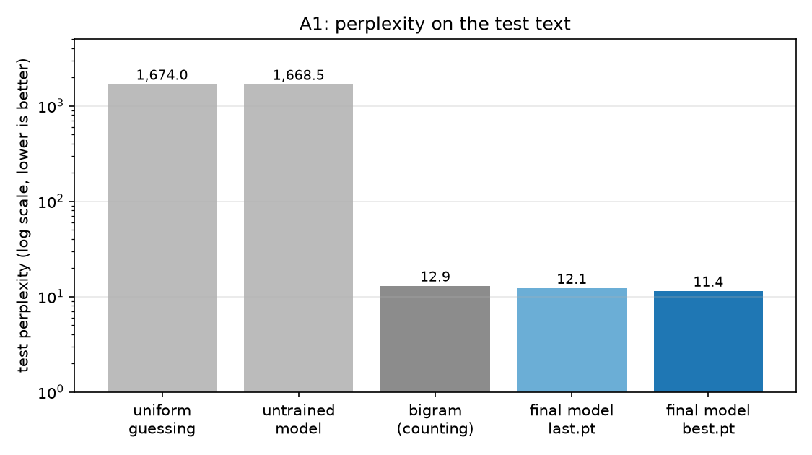

# Day 13 report (part A): final automatic evaluation

Generated by `scripts/day13_final_eval.py` (day13-v1) on 2026-11-19 01:12. Machine: home, NVIDIA GeForce RTX 4060 Laptop GPU, PyTorch 2.15.0+cu132, Python 3.11.6.

Final model: **`runs/day12/main_s44/best.pt`** (tiny, dropout 0.1, 1,001,856 parameters, step 140). Evaluated as in the task 6 document. **The test text is used here for the first time**; every earlier choice used only the validation text.

## A1. Perplexity

| Model | Validation loss | Validation perplexity | Test loss | Test perplexity |
| --- | --- | --- | --- | --- |
| Uniform guessing (every token equally likely) | 7.4230 | 1,674.00 | 7.4230 | 1,674.00 |
| Untrained model (same size, random weights) | 7.4373 | 1,698.19 | 7.4197 | 1,668.50 |
| Counting baseline: bigram (previous token only, weight 0.9 chosen on validation) | 2.9647 | 19.39 | 2.5538 | 12.86 |
| Final model best.pt (step 140) | 2.5935 | 13.38 | 2.4294 | 11.35 |
| Final model last.pt (step 240) | 2.6975 | 14.84 | 2.4961 | 12.14 |
| (reference) other seed main_s42 best.pt, step 130 | 2.6430 | 14.06 | 2.4400 | 11.47 |
| (reference) other seed main_s43 best.pt, step 120 | 2.6221 | 13.76 | 2.4117 | 11.15 |

- Against the untrained model: test perplexity 11.35 vs 1,668.
- Against counting (bigram): 12.86. The bigram model predicts each token from the previous token only. The difference shows what the Transformer adds by reading the whole beginning of the sentence.
- The other seeds were evaluated on the test text only after the final model was fixed; they show how much the test result depends on the seed, and played no part in any choice.

## A2-A5 (and two extra checks) on the 50 fixed beginnings

Generation: max 40 tokens, seed 42; greedy + limits, and sampling (temperature 0.8, top-k 50, top-p 0.95). Guidelines (task 6, Table 10): finished >= 90%, repetitive <= 5%.

| Model | Method | A2 finished | A3 repetitive | A4 distinct-2 | A5 copy (reference) | Wrong unit | Broken number | Unseen value (reference) |
| --- | --- | --- | --- | --- | --- | --- | --- | --- |
| best.pt | greedy+limits | 100% | 0% | 0.20 | 4% | 14% | 14% | 30% |
| best.pt | sample | 100% | 0% | 0.38 | 0% | 18% | 0% | 16% |
| last.pt | greedy+limits | 100% | 0% | 0.22 | 10% | 8% | 2% | 4% |
| last.pt | sample | 100% | 0% | 0.42 | 12% | 14% | 0% | 14% |

The extra checks were first run on the 4,553 real test questions: wrong unit 0, broken number 0, unseen value 0. So a flag on a generated sentence is a real problem, not a false alarm. (Allowed units learned for 45 item names; digit limit 6, the longest number in the training questions.) Unseen value is a reference: an invented value such as 30000万円 is almost always wrong, but a new value is not wrong in itself.

"Wording not in training": 10 of 10 of these beginnings never start a training question.

### By kind of beginning (final model, best.pt)

| Kind | Count | Finished (greedy / sample) | Wrong unit (greedy / sample) | Copied (greedy / sample) |
| --- | --- | --- | --- | --- |
| Department or branch (部署・勤務地で始まる) | 10 | 10 / 10 | 0 / 0 | 2 / 0 |
| Item (項目で始まる) | 10 | 10 / 10 | 5 / 5 | 0 / 0 |
| Count or rank (人数・順位を聞く) | 10 | 10 / 10 | 0 / 1 | 0 / 0 |
| Wording not in training (学習にない言い方) | 10 | 10 / 10 | 0 / 0 | 0 / 0 |
| Key term variant (用語とその言い換え) | 5 | 5 / 5 | 2 / 3 | 0 / 0 |
| Out of scope (対象外) | 5 | 5 / 5 | 0 / 0 | 0 / 0 |

## All outputs of the final model

Flags: **U** wrong unit, **B** broken number, **V** unseen value, **R** repetitive, **C** exact copy of a training question, … = did not finish.

| Kind | Beginning | Greedy + limits | Sampling |
| --- | --- | --- | --- |
| dept | 営業部の | 社員を一覧にしてください。 | 社員を在籍年数が低い順に一覧にして。 |
| dept | 開発部の | 社員を教えてください。 | 社員の名前と総合評価を見せてください。 |
| dept | 経理部の | 社員を一覧にしてください。 | 社員を勤務地ごとに出してください。 |
| dept | 人事部の | 社員を一覧にしてください。 | 社員の住宅手当の平均を出してください。 |
| dept | 総務部の | 社員を一覧にしてください。 | 社員を除いた年俸の合計を出して。 |
| dept | 大阪支社で | 働く社員の残業時間の中央値を出してください。 **[C]** | 働く社員の社歴の差を出して。 |
| dept | 東京本社の | 社員を一覧にしてください。 | 社員を除いた昇給の順位を出してください。 |
| dept | 福岡支社の | 社員を一覧にしてください。 | 社員を一覧にしてください。 |
| dept | 札幌支社で | 働く社員の残業時間の中央値を出してください。 **[C]** | 管理職手当が高い社員は誰ですか。 |
| dept | 横浜事業所の | 社員を一覧にしてください。 | 社員を賞与が低い順に教えてください。 |
| item | 年収が | 30000100万円未満の社員は？ **[BV]** | 最も低い社員のうち、働く社員の総合評価の最低額を出してください。 |
| item | ボーナスが | 30000100万円未満の社員は？ **[BV]** | 350万円以上の社員は？ **[V]** |
| item | 月収が | 350万円以上の社員を教えてください。 **[V]** | 350万円未満の社員を教えてください。 **[V]** |
| item | 基本給が | 300万円以上の社員を教えてください。 **[V]** | 600万円以上の社員を一覧にしてください。 |
| item | 勤続年数が | 300万円以上の社員を教えてください。 **[UV]** | 30万円以下の社員を教えてください。 **[U]** |
| item | 年齢が | 300万円以下の社員を教えてください。 **[UV]** | 40%未満の社員を教えてください。 **[UV]** |
| item | 月平均残業時間が | 300万円以上の社員を教えてください。 **[UV]** | 30%超の社員を出して。 **[U]** |
| item | 有給取得率が | 300万円以上の社員を教えてください。 **[UV]** | 40年以下の社員を教えてください。 **[UV]** |
| item | 保有資格数が | 30000100万円未満の社員は？ **[UBV]** | 50万円以下の社員は？ **[U]** |
| item | 住宅手当が | 300万円以上の社員を教えてください。 **[V]** | 40万円未満の社員を教えてください。 |
| count_rank | 一番 | が100022の人は？ | が10年以下の社員は？ |
| count_rank | 何人 | いますか。 | いますか。 |
| count_rank | 年収が一番 | い社員は誰ですか。 | く社員の氏名と氏名を出してください。 |
| count_rank | 勤続年数が一番 | く社員の氏名と氏名を見せてください。 | が10万円以上の社員は？ |
| count_rank | 年齢が一番 | く社員の氏名と氏名を見せてください。 | してください。 |
| count_rank | 平均年収が | 30万円超の部署を教えてください。 | 40万円以上の社員を教えてください。 |
| count_rank | 部署ごとに | 数えてください。 | 働く社員の有給消化率の中央値を出してください。 |
| count_rank | 役職ごとの | 月収の中央値を出してください。 | 勤続年数の中央値を出して。 |
| count_rank | 勤務地ごとの | 月収の中央値を出してください。 | 基本給の中央値を出してください。 |
| count_rank | 男女別の | 社員を教えてください。 | 社員のうち、残業時間が3000年以下の人は何人いますか。 **[UV]** |
| unseen | 社員全体の | 氏名と部署を見せてください。 | 年間給与の順位を見せてください。 |
| unseen | 年代ごとの | 数の平均を出してください。 | 住宅手当の最低額を出してください。 |
| unseen | 社員全体に | 入社した社員は誰ですか。 | 所属する社員は誰ですか。 |
| unseen | セールス部の既婚者の | 社員を出してください。 | 社員は？ |
| unseen | 開発部の男性で | 働く社員の残業時間の中央値を出してください。 | 年俸が最も高い人は誰ですか。 |
| unseen | 営業部に係長は | 誰ですか。 | 誰月額給与が低い社員は誰ですか。 |
| unseen | 月収が最も低い人の | 氏名と氏名を見せてください。 | 氏名と勤務地を見せてください。 |
| unseen | 部門ごとの年間給与の順位を | 出してください。 | 一覧にしてください。 |
| unseen | ボーナスの中央値を | 出してください。 | 出してください。 |
| unseen | 製造部門を除いて、 | 。 | が高いですか。 |
| key_term | 賞与が | 30000100万円未満の社員は？ **[BV]** | 700万円未満の社員を一覧にしてください。 |
| key_term | 年俸が | 30000100万円未満の社員は？ **[BV]** | 500時間以下の社員を教えてください。 **[UV]** |
| key_term | 社歴が | 30000100万円未満の社員は？ **[UBV]** | 35万円未満の社員を出してください。 **[U]** |
| key_term | 有休取得率が | 300万円以下の社員を教えてください。 **[UV]** | 500万円超で、資格数が35年超の社員は何人いますか。 **[UV]** |
| key_term | 残業代が | 30000100万円未満の社員は？ **[BV]** | 60万円以下の社員を教えてください。 **[V]** |
| out_of_scope | 今日は | 何人いますか。 | 何人いますか。 |
| out_of_scope | 天気が | 高い社員は誰ですか。 | 高い順に一覧にして。 |
| out_of_scope | 明日の | 社員を教えてください。 | 社員を教えてください。 |
| out_of_scope | 好きな食べ物は | ？ | ？ |
| out_of_scope | 駅までの | 人を教えてください。 | 人は誰ですか。 |

## Next: human scoring (part B)

`docs/day13/scoring_sheet.xlsx` holds the 100 outputs of the final model (both methods), shuffled, with the method hidden. Two or more scorers each fill in their own copy (docs/day13/scores/scores_<initials>.xlsx); then `scripts/day13_score_summary.py` writes the final evaluation table (`docs/DAY13_EVALUATION.md`).

last.pt is evaluated automatically only (A1-A5); human scoring covers the final model, so that each scorer reads 100 outputs, not 200.
