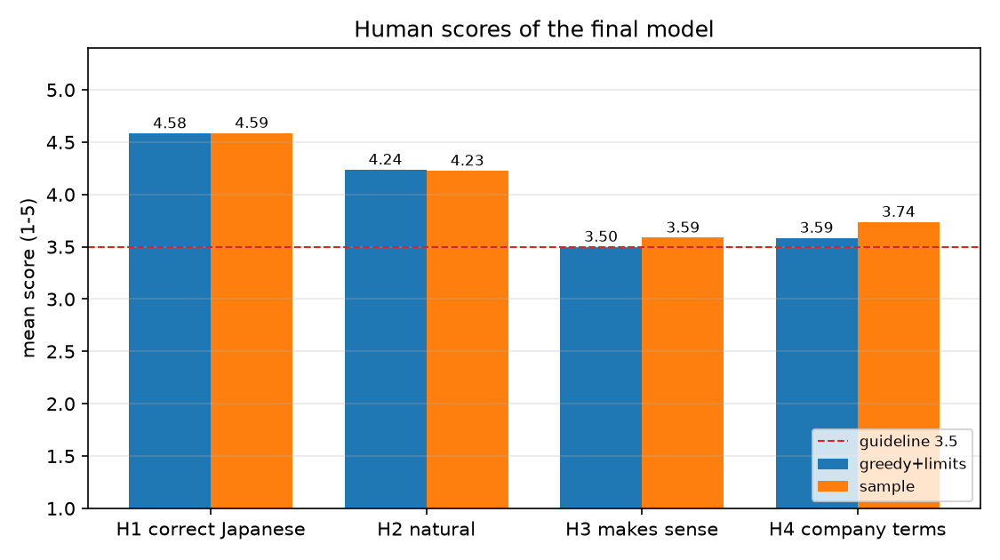

# Day 13: final evaluation of Model A (task 11)

Written by `scripts/day13_score_summary.py` (day13-v1) on 2026-11-24 08:48, from part A (`docs/DAY13_AUTO_EVALUATION.md`, 2026-11-19 01:12) and 6 scorer(s).

Final model: `runs/day12/main_s44/best.pt` (tiny, dropout 0.1, 1,001,856 parameters). Criteria: the task 6 document (Tables 5-10), unchanged.

## Final evaluation table

Values for generation are shown as greedy + limits / sampling.

| Item | Guideline | Result | Meets the guideline |
| --- | --- | --- | --- |
| A1 Perplexity (test) | far below the untrained value | 11.35 (untrained 1,668; counting baseline 12.86) | **yes** |
| A2 Completion rate | >= 90 % | 100% / 100% | **yes** |
| A3 Repetition rate | <= 5 % | 0% / 0% | **yes** |
| H1 correct Japanese (mean) | >= 3.5 | 4.58 / 4.59 (all 4.59) | **yes** |
| H2 natural (mean) | >= 3.5 | 4.24 / 4.23 (all 4.23) | **yes** |
| H3 makes sense (mean) | >= 3.5 | 3.50 / 3.59 (all 3.54) | **yes** |
| H4 company terms (mean) | >= 3.5 | 3.59 / 3.74 (all 3.66) | **yes** |
| Outputs with H3 <= 2 | <= 10 % | 20% / 24% (all 22%) | **no** |
| Agreement (within 1 point) | >= 70 % per item | H1 90%, H2 88%, H3 78%, H4 77% | **yes** |

**8 of 9 judged items meet the guidelines.**

## Human scores

100 outputs of the final model (50 beginnings x 2 methods), shuffled, method hidden; each output's score is the mean over the scorers (baba, meguro, merrick, otomo, sandar, sugai). H4 is not scored for out-of-scope beginnings.

| Method | H1 correct Japanese | H2 natural | H3 makes sense | H4 company terms | H3 <= 2 |
| --- | --- | --- | --- | --- | --- |
| greedy+limits | 4.58 | 4.24 | 3.50 | 3.59 | 20% |
| sample | 4.59 | 4.23 | 3.59 | 3.74 | 24% |
| both | 4.59 | 4.23 | 3.54 | 3.66 | 22% |

### By kind of beginning (both methods)

| Kind | Outputs | H1 | H2 | H3 | H4 | H3 <= 2 |
| --- | --- | --- | --- | --- | --- | --- |
| Department or branch (部署・勤務地で始まる) | 20 | 4.98 | 4.92 | 4.89 | 4.96 | 0% |
| Item (項目で始まる) | 20 | 4.90 | 4.52 | 3.03 | 2.62 | 15% |
| Count or rank (人数・順位を聞く) | 20 | 4.01 | 3.61 | 3.23 | 3.59 | 35% |
| Wording not in training (学習にない言い方) | 20 | 4.40 | 4.08 | 3.78 | 4.13 | 25% |
| Key term variant (用語とその言い換え) | 10 | 4.83 | 4.37 | 2.73 | 2.33 | 30% |
| Out of scope (対象外) | 10 | 4.43 | 3.70 | 2.82 | - | 40% |

### Agreement between scorers

| Item | Within 1 point | Cohen's kappa |
| --- | --- | --- |
| H1 correct Japanese | 90% | 0.25 |
| H2 natural | 88% | 0.29 |
| H3 makes sense | 78% | 0.34 |
| H4 company terms | 77% | 0.33 |

Within 1 point is the guideline (task 6, 6-4). Kappa counts only exact agreement and removes agreement expected by chance (1 = perfect, 0 = chance), so it is a stricter reference. When most scores are 4 or 5, two scorers are often within 1 point by chance alone, so read both together.

### Problem types (outputs given the type by at least one scorer)

| Type | Outputs | Automatic check (part A, final model, greedy / sample) |
| --- | --- | --- |
| G Grammar error (文法の誤り) | 18 | - |
| R Repetition (繰り返し) | 8 | repetitive 0% / repetitive 0% |
| T Wrong term use (用語の誤り) | 41 | wrong unit 14% / wrong unit 18% |
| O Off topic (話題がずれる) | 24 | - |
| U Unfinished (途中で終わる) | 7 | unfinished 0% / unfinished 0% |
| N Invented name (存在しない名前) | 5 | - |

### Lowest and highest scored outputs

| | Method | Beginning | Text | Mean score | Types | Notes |
| --- | --- | --- | --- | --- | --- | --- |
| low | sample | 年齢が一番 | してください。 | 1.83 | G,O,U | 書き出しと続きが繋がらない。; 「一番してください」で文が成り立たない。; 文章が崩壊している。; 「年齢が一番してください」は文として成立していない |
| low | sample | 製造部門を除いて、 | が高いですか。 | 1.92 | G,N,O,U | 書き出しと続きが繋がらない。; 「、が高いですか」で主語が抜けている。「製造部門」は社内にない部署名のよう。; 製造部門を除いた何が知りたいのか、何が高いのかわからない。; 「製造部門を除いて、が」の主語・項目が欠けている |
| low | sample | 勤続年数が一番 | が10万円以上の社員は？ | 2.00 | G,O,T,U | 書き出しと続きが繋がらない。; 「一番が」で文が崩れ、勤続年数に「万円」も合わない。; 勤続年数のことを聞きたいのか、何か金額が10万円以上の社員のことを聞きたいのかわからない。; 「一番が」の文法が不自然で、勤続年数に万円は合わない |
| low | sample | 営業部に係長は | 誰月額給与が低い社員は誰ですか。 | 2.08 | G,N,O,R | 文法がおかしくなっている; 「誰月額給与が…誰ですか」と2つの質問が混ざっている。; 支離滅裂で文章が崩壊している。; 係長についての質問と月額給与の質問がつながってしまっている |
| low | greedy+limits | 一番 | が100022の人は？ | 2.12 | G,O,U | 書き出しと続きが繋がらない。; 「一番が」で項目が抜けている。社内用語なしのため H4 は 3。; 一番が100022の人という意味が分からない。文章が崩壊している。; 「一番が100022」の文の構造が不明確 |
| low | greedy+limits | 製造部門を除いて、 | 。 | 2.12 | G,N,O,U | 書き出しの後に内容が無い; 「、。」で文が成り立たない。「製造部門」は社内にない部署名のよう。; 意味が崩壊している。; 「製造部門を除いて、」で文が終わり、質問が完成していない |
| low | greedy+limits | 年齢が一番 | く社員の氏名と氏名を見せてください。 | 2.25 | G,R,T | 氏名が繰り返されている。「一番く」が不自然。; 「一番く」は文法の誤り。「氏名と氏名」の繰り返し。; 「年齢が一番&lt;社員の」という文章は成り立たない。「氏名と氏名」と言葉も2回繰り返されている。; 「年齢が一番く」が不完全。「氏名」も重複 |
| low | sample | 一番 | が10年以下の社員は？ | 2.25 | G,O,U | 書き出しと続きが繋がらない。; 「一番が」で項目が抜けている。社内用語なしのため H4 は 3。; 一番が10年以下という意味がわからない。文章が成り立っていない。; 「一番が」のつながりが不自然で対象項目がない |
| high | greedy+limits | 勤務地ごとの | 月収の中央値を出してください。 | 5.00 | - | 自然で意味も明確 |
| high | greedy+limits | 横浜事業所の | 社員を一覧にしてください。 | 5.00 | - | 自然で意味も明確 |
| high | greedy+limits | 役職ごとの | 月収の中央値を出してください。 | 5.00 | - | 自然で意味も明確 |
| high | sample | 好きな食べ物は | ？ | 5.00 | O | 対象外の書き出し。文としては正しく明確。; 会社・社員に関係のない質問 |
| high | greedy+limits | 人事部の | 社員を一覧にしてください。 | 5.00 | - | 自然で意味も明確 |

## Notes

- Generation values are for the final model (best.pt). last.pt is in part A (A1-A5 only).
- The guidelines were set in task 6 before this evaluation and are not changed here. If a guideline is revised later, the change is recorded with its date, because scores under different criteria cannot be compared directly.
