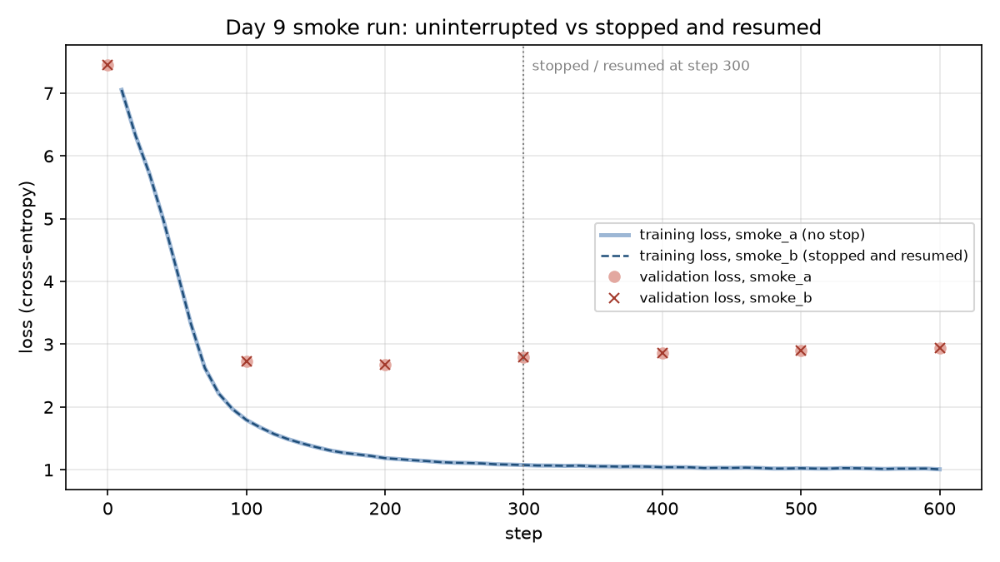

# Day 9 report: smoke run, stop and resume

Generated by `scripts/day9_compare_runs.py` on 2026-11-14 18:39.
Runs: `runs/day9/smoke_a` (no stop) and `runs/day9/smoke_b` (stopped at step 300, then resumed).
Model config `configs/model_tiny.json`; batch 32 x accum 1; 600 steps; peak learning rate 0.001; warm-up 60 steps.

## Resume check

| Check | Result |
| --- | --- |
| same final step | PASS |
| training losses match | PASS |
| validation losses match | PASS |
| no jump at the resume step | PASS |
| largest difference between the runs (loss) | 0.00e+00 |
| verdict | **identical** |

## Learning

| | Step 0 (before training) | Final |
| --- | --- | --- |
| validation loss | 7.4462 | 2.9394 |
| validation perplexity | 1713.3 | 18.90 |
| training loss | - | 1.0079 |

Training tokens seen: 4,915,200 (2.42 passes over the training text). Median speed 610,754 tokens/s. Peak GPU memory 407 MB.

## Greedy samples (run smoke_a)

## step 0 (validation loss 7.4462)

| Prompt | Greedy continuation |
| --- | --- |
| 営業部の | のののののののののののののののののののののののののののののののののののののののの |
| ボーナスが | がががががががががががががががががががががががががががちちちちちちちちちちちちち |
| 大阪支社で | でででででででででででででででででででででででででででででででででででででででで |
| 社員の平均 | 平均平均平均平均平均平均平均平均平均平均平均平均平均平均平均平均平均平均平均平均平均平均平均平均平均平均平均平均平均平均平均平均平均平均平均平均平均平均平均平均 |

## step 600 (validation loss 2.9394)

| Prompt | Greedy continuation |
| --- | --- |
| 営業部の | 社員のうち、月給が一番低い人は誰ですか。 ⟨eos⟩ |
| ボーナスが | 150万円未満の社員のうち、月額給与が30万円未満の人は誰ですか。 ⟨eos⟩ |
| 大阪支社で | 働く社員の時間外手当の中央値を出してください。 ⟨eos⟩ |
| 社員の平均 | を一覧にしてください。 ⟨eos⟩ |
